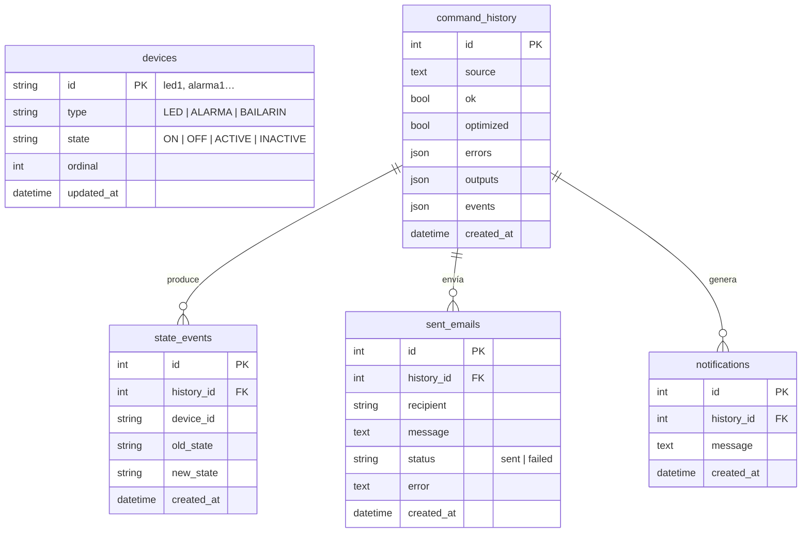

# API REST y base de datos

Swagger interactivo: `http://localhost:8000/docs` (esquema OpenAPI en `/openapi.json`).
Si existe `backend/static` (interfaz compilada), la API también la sirve en `/`.

## Endpoints

| Método | Ruta | Descripción |
|---|---|---|
| GET | `/api/health` | Comprueba API y conexión a la base de datos |
| GET | `/api/config` | URL de Mailpit, límite de tamaño y modo de correo (`email.real`, servidor, puerto, cifrado; **nunca** credenciales) |
| GET | `/api/devices` | Dispositivos y su estado actual |
| POST | `/api/devices/reset` | Restablece los dispositivos a su estado inicial |
| POST | `/api/commands` | **Compila y ejecuta** un programa `{ "source": "...", "optimize": true, "preserve_events": true }` |
| POST | `/api/compile` | Valida y genera IR **sin ejecutar ni guardar** |
| GET | `/api/history?limit=` | Programas enviados (correctos y con errores) |
| DELETE | `/api/history` | Borra historial, eventos y correos registrados |
| GET | `/api/events?limit=` | Bitácora de cambios de estado |
| GET | `/api/emails?limit=` | Intentos de envío de correo con `status` (`sent` / `failed`) y `error` |
| GET | `/api/notifications?limit=` | Notificaciones generadas con `NOTIFICAR` |

### Respuesta de `POST /api/commands`

```json
{
  "ok": true,
  "message": "OK",
  "errors": [],
  "outputs": [{ "kind": "consulta", "text": "led1 (LED): ENCENDIDO", "detail": "" }],
  "events":  [{ "device": "led1", "old": "APAGADO", "new": "ENCENDIDO", "text": "led1: APAGADO → ENCENDIDO" }],
  "devices": [{ "id": "led1", "type": "LED", "state": "ON", "state_es": "ENCENDIDO" }],
  "history_id": 7,
  "compilation": {
    "tokens": [{ "line": 1, "col": 1, "type": "ENCENDER", "lexeme": "ENCENDER" }],
    "ast": { "nodo": "Program", "instructions": [] },
    "instructions": [],
    "ir": ["SET_STATE led1 ON", "HALT"],
    "optimized_ir": ["SET_STATE led1 ON", "HALT"],
    "optimizations": []
  }
}
```

**Convención de errores:** los errores *del lenguaje* (léxico, sintáctico, semántico, de ejecución) devuelven
HTTP **200** con `ok: false` y la lista `errors` (`tipo`, `mensaje`, `linea`, `columna`), porque son un resultado
esperado del análisis, no un fallo del servidor. Un programa de más de 5000 caracteres devuelve **422**.

## Modelo de datos



**Importante al actualizar:** `create_all` no modifica tablas existentes. Si ya levantaste una versión anterior con
PostgreSQL, ejecuta una vez `docker compose down -v` para recrear la base (las migraciones con Alembic están
propuestas en la tarjeta API-07). Los dispositivos de tipos que ya no existen (el antiguo `VENTILADOR`) se
eliminan solos al arrancar.

`devices` guarda el **estado actual**; `state_events` es la **bitácora** de cada cambio efectivo; `command_history`
guarda cada intento (también los fallidos) con su resultado completo.

## Flujo de una ejecución

1. Se toma un bloqueo de proceso y una transacción con `SELECT … FOR UPDATE` sobre `devices`
   (serializa ejecuciones concurrentes, incluso entre varios procesos con PostgreSQL).
2. Se reconstruye la `SymbolTable` desde la base de datos.
3. `CommandFlow.run()` ejecuta léxico → sintaxis → semántica → IR → optimización → VM.
4. Se guardan estados, historial, eventos y correos en la **misma transacción** y se hace *commit*.

Si la validación falla, no se ejecuta nada y solo se guarda el intento en el historial. Si un error de
**ejecución** (por ejemplo, SMTP caído) ocurre a mitad del programa, los efectos ya aplicados sobre los
dispositivos se conservan y se informan, porque no pueden deshacerse.

## Variables de entorno

| Variable | Valor por defecto | Uso |
|---|---|---|
| `DATABASE_URL` | `sqlite:///./commandflow.db` | En Docker: `postgresql+psycopg://…@postgres:5432/…` |
| `SMTP_HOST` / `SMTP_PORT` | `localhost` / `1025` | En Docker: `mailpit` / `1025` |
| `CORS_ORIGINS` | `http://localhost:5173` | Orígenes permitidos (lista separada por comas) |
| `MAILPIT_UI_URL` | `http://localhost:8025` | Enlace que muestra la interfaz |
| `SMTP_USER` / `SMTP_PASSWORD` | vacío | Proveedor externo (opcional): activa el inicio de sesión SMTP |
| `SMTP_STARTTLS` / `SMTP_SSL` | `false` | Cifrado con STARTTLS (587) o SSL directo (465) |
| `SMTP_FROM` | `commandflow@localhost` | Remitente de los correos |
